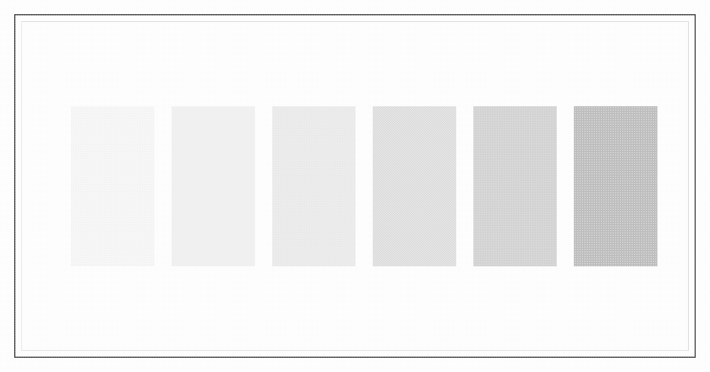

# Houses of Liankou

Named in the manner of a special zone: a development company, a harbor bureau, a foreign plant, and a thin private edge.

## State

- [Zone Committee](zone-committee.md)
- [Liankou Development Company](huanan-development.md) (联口工业发展总公司)
- [Harbor Bureau](harbor-bureau.md) (联口港务局)

## Foreign plant

- [Lianhe Electronics](lianhe.md) (联和电子有限公司), Hong Kong invested, site leased

## Small private

- [Shunfa Trading](shunfa.md) (顺发贸易)
- [Desheng Workshop](desheng.md) (德胜加工场)
- [Weyue](weyue.md) (伟裕), ticket desk
- [Minfa Lighters](minfa.md) (闽发驳船)
- [Xinji Repair](xinji.md) (新纪修配)

## Band

- [White Crane Association](white-crane.md) (白鹤会)
