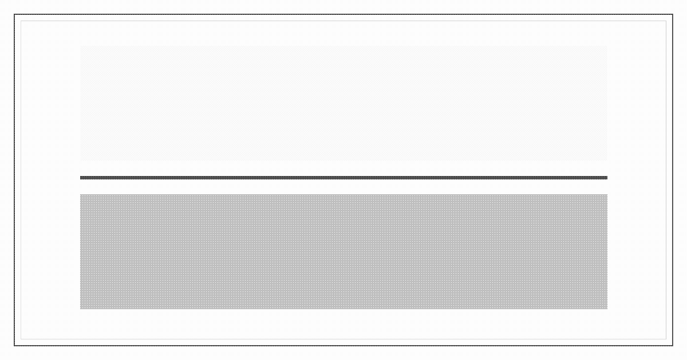

# Economy of Liankou

Liankou is an export-processing zone on a dual track, 双轨制. Foreign exchange earned inside the fence can be retained. A 许可证 lets a worker in for a shift. A 户口 does not follow.

The state holds the ground and the gate. [Liankou Development](huanan-development.md) owns the sites. The [Harbor Bureau](harbor-bureau.md) owns the berths. [Lianhe Electronics](lianhe.md) is the foreign plant the zone was opened to receive. Shed workshops and ticket desks take the remainder.

The [Regulation Office](regulation-office.md) scores bunks, water, and clearances off the export feed. That office is the zone's fiction. The contracts, the seal, and the permit are not.
