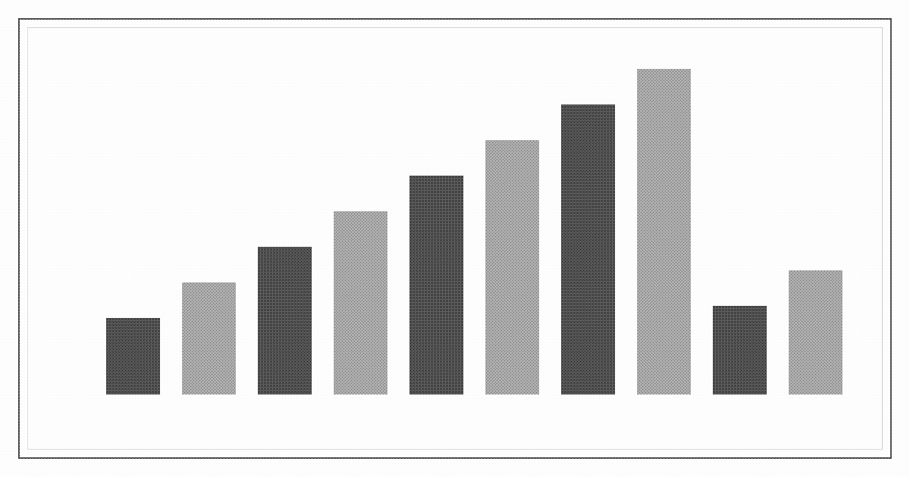

# Expert systems in Liankou

**Expert systems in Liankou** are knowledge-based systems operated by the [Regulation Office](regulation-office.md) to score and allocate resources inside the [Liankou Special Zone](liankou.md). Each system comprises a domain knowledge base of production rules and an inference engine that applies those rules to live relational feeds from docks, mills, dormitories, and customs. The output is a weighted token. The systems form the machine layer of [Project Tiaojie](project-tiaojie.md).

The Zone Committee classifies the installation as a modernization of planning under regulation by the market. Operators call the crown halls the operations room. In the lower stack the outputs are called the weights.

## Background

Late-1970s and early-1980s expert systems encoded specialist procedures as IF–THEN production rules and executed them with a separate inference engine. Shells such as EMYCIN and OPS5 separated the knowledge base from the control regime (forward chaining, backward chaining, or mixed). Certainty factors or equivalent scoring attached to rules allowed ranked rather than binary conclusions. The principal bottleneck was knowledge engineering: extracting and maintaining the rules.

The Japanese Fifth Generation Computer Systems project (ICOT, 1982–1992) proposed machines oriented to knowledge information processing rather than numerical calculation: logic programming (Prolog and later concurrent variants), parallel inference, and large relational knowledge bases. Most results remained research prototypes.

Liankou adopted the production-rule architecture and the fifth-generation emphasis on inference over calculation, without joining an external institute. Initial Regulation Office links were telex. Clerks reduced reports by hand. Machine replacement occurred in the early 1980s. Inference boards were supplied by [Lixin Precision](lixin.md) until the firm’s seizure.

## Knowledge representation

Rules are production rules stored in relational tables. A typical customs rule takes the form: if vessel class, cargo code, prior clearance history, and declared value satisfy a conjunction, then assign clearance weight *w* with confidence *c*. Labor rules bind shift, skill code, bunk occupancy, and water quota. Rules carry maintenance metadata: authoring engineer, revision, and effective window.

The knowledge base is not a free-text corpus. It is a versioned set of relations. Domain boundaries are strict. A customs knowledge base contains no bunk predicates. Cross-domain reduction is performed only at the Regulation Office layer, which reads the scored outputs and applies a second, smaller rule set to emit the allocation token.

Knowledge engineers work in the upper city. A rule change is an administrative commit. The live base is not replicated below the service band.

## Software

### Rule language

Rules are written in a production-rule notation maintained by the Regulation Office. Surface syntax is a restricted IF–THEN form with typed predicates:

```
IF vessel.class = "bulk"
   AND cargo.code IN bonded_list
   AND history.clearance_count >= 3
   AND declared_value < threshold(cargo.code)
THEN clearance.weight += 0.4
CONFIDENCE 0.85
```

Predicates are drawn from a domain schema. Free variables are not permitted in committed rules. The language is compiled to an internal relational form before loading. There is no general-purpose procedural escape in the committed base. Side computations (threshold lookups, date windows) are performed by registered functions held outside the rule text.

The notation descends from early-1980s shells (OPS5-style productions, EMYCIN certainty attachment) rather than from a pure logic-programming syntax. A concurrent-logic subset, influenced by the Fifth Generation emphasis on committed-choice languages, is used only inside the inference engine for partition scheduling. Knowledge engineers do not write that subset.

### Knowledge-base management

Each domain knowledge base is a versioned relational store. A commit records the engineer identifier, the rule delta, the effective window, and a countersignature from the office. Live bases are copy-on-write at the partition level. Rollback is an office operation, not an engineer privilege. Diffs are retained in the crown halls and are not published below the service band.

Bootleg listings are transcriptions or partial dumps of earlier revisions. They lack current confidence values and the registered-function table. They cannot be loaded into a live engine.

### Inference engine

The engine is a forward-chaining production system with a Rete-derived discrimination network for the common case, rebuilt for the zone’s partitioned hardware. Working memory holds the current feed records. The conflict set is ordered by specificity (number of conditions matched) then by rule confidence. Parallel firing across independent partitions was added in the early-1980s reconstruction to meet dock cycle targets. The office identifies this scheduler as the fifth-generation increment.

Backward chaining is supported for operator-initiated exception queries. It is not the default path for the live feed. Certainty combination follows a MYCIN-style certainty-factor update: positive and negative factors are combined algebraically and clamped. The final normalized weight is written back to the relational store and becomes the token payload.

The engine will not synthesize new predicates. A query that matches no rule returns a null weight and an exception flag. There is no learning component. Rule induction from cases was trialed in the early reconstruction and withdrawn. All rules in service are hand-authored.

### Shells and tooling

Knowledge engineers use an upper-city shell: a cathode editor for the rule notation, a static checker against the domain schema, and a shadow engine that replays a recorded feed against a proposed commit. The shadow run does not touch live working memory. A commit that fails the shadow comparison on a golden set of prior clearances is rejected. The shell does not run below the service band.

### What is absent

No general theorem prover is exposed. No natural-language front end is in service. The fifth-generation goal of a knowledge-information processing system that could accept unconstrained queries was not met. The systems accept structured records and return weights. Natural-language appeals, where they exist, are handled by clerks at the service band and do not enter the engine.

## Hardware and deployment

Live knowledge bases and engines occupy climate-controlled halls in the finished crown. Inference hardware uses zone-maintained boards derived from the Lixin designs: multiple inference units over a shared relational store, with cathode monitoring stations for the operators. Power and cooling are crown services. The lower stack receives only the token stream.

Feeds arrive by leased line and, inside the wall, by dedicated cable drops. Update latency for a dock token is measured in minutes, not batch days. A weight change can reassign a shift or hold a hull inside a single reporting cycle.

Retired cathode tubes are rebuilt into display boards in the lower city. These reproduce phosphor characteristics. They do not execute live rules.

## Operational examples

The following are representative live cycles. Figures are illustrative of the rule form in service. They are not a published operations log.

### Dock clearance

A bulk carrier reports at the outer buoy: class bulk, cargo code on the bonded list, three prior clearances in the current quarter, declared value under the cargo threshold. The customs engine forward-chains. Three rules match. Specificity orders them. Certainty factors combine to a clearance weight of 0.82. The office supervisory rule emits a berth token and a discharge window. Elapsed time from report to token is under one reporting cycle. The hull proceeds. No clerk retypes the declaration.

### Failed clearance

A second hull reports the same class and cargo code but with a declared value above threshold and a prior failed inspection flag. Two rules fire negative factors. Combined weight falls to 0.31, below the clearance threshold. The engine writes a null-success token and an exception flag. The operations room cathode shows the flag. The hull is held at the buoy. The exception does not auto-appeal. A service-band clerk may open a manual review. The manual review does not rewrite the knowledge base.

### Bunk and water assignment

A temporary-worker record arrives from a mill: skill code matched to an open shift, current bunk occupancy on that rib at 0.94, water quota for the slab already at the daily cap. The labor engine fires a positive skill rule and two negative resource rules. Net weight 0.44. The office rule assigns the shift but withholds the bunk token and issues a water-wait flag. The worker receives a shift ticket and no bed assignment. The landing sees a man with a valid shift paper and nowhere to sleep. The system records the outcome as an allocation, not an exception.

### Mid-cycle shift reassignment

A mill reports a machine fault that idles one line. The labor feed updates. Forward chaining re-evaluates open shifts against the new idle flag. A rule with higher specificity than the original assignment fires. Confidence is sufficient. The office emits a revised token canceling four shift tickets and opening two on an adjacent line. The change appears on the next horn. Workers who do not hear the horn discover the cancellation at the gate. The system does not push a spoken notice below the band.

### What the examples exclude

None of the cycles accepts free-text input. None invents a rule to cover a missing predicate. A cargo code absent from the schema produces a null weight and an exception, not an estimated clearance. Knowledge engineers may later add the predicate. Until the commit and countersignature, the null stands.

## Bootleg weights

Partial rule listings circulate in the lower stack, sold as aids to anticipate or counterfeit a token. They are static extracts. They do not connect to the live relational store and rarely reproduce current confidence values. Possession is not systematically prosecuted. The office does not publish diffs.

## Political and administrative status

The Zone Committee files the halls under regulation by the market inside the plan. Official descriptions do not claim abolition of commodity exchange. They claim accelerated clearance and labor allocation through maintained rules. Altering a rule is an upper-city procedure requiring a knowledge-engineer commit and an office countersign. Being subject to the resulting weight is the condition of a temporary permit.

## See also

- [Project Tiaojie](project-tiaojie.md)
- [Regulation Office](regulation-office.md)
- [Lixin Precision](lixin.md)

## Notes

Certainty-factor scoring follows the MYCIN-derived practice common in early-1980s shells. No claim is made to later probabilistic graphical models.
