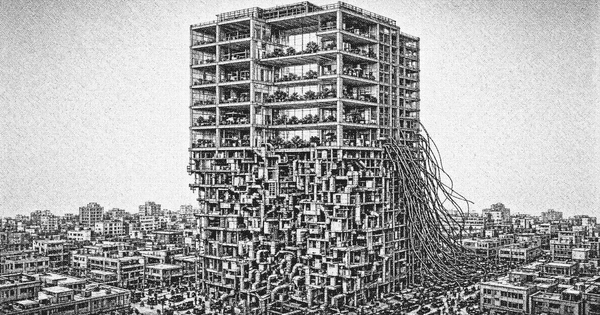

# Geography of Liankou

Liankou is a walled coastal site. The wall keeps the experiment from spilling inland and keeps inland rules from applying once inside. The structure stands in the city, not apart from it. The crown is finished. Below the service band the floors were added faster than they were drawn: rooms bolted on, stairs cut through ducts, cables run down the face into the neighboring blocks.

## Upper city

Shangcheng (上城) is the sealed crown: atria, joint-venture galleries, private courts, and the operations room of the [Regulation Office](regulation-office.md). The air is dry. The seals are corporate. Reception water is borrowed.

## Service band

The service band (中带) is the mechanical and legal threshold. Freight, water, power, and bought access cross it. House security stands here. Appeals stop here. Brokers from the zone committee and Huanan Development meet on this band because it is the highest floor where both dialects are spoken.

## Lower city

The lower stack (下栈) is the occupied remainder. Address is a rib, then a landing. Stairs were cut where drawings showed ducts. A landing becomes an address because mail and shake-downs both need a name. The ceiling is the floor of a deck the landing does not live on.
