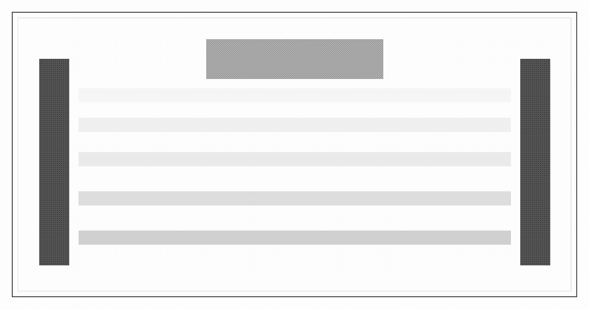

# Liankou

**Liankou** (联口市), formally the **Liankou Special Zone** (联口特别区), is a walled coastal city and special economic zone on the south China coast, opened in 1978. It was designated an experimental port for outside capital, export manufacture, and a cybernetic coordination system, on a holiday from the interior plan. The holiday was extended with each published growth series. By the mid-1980s the wall was still the municipal boundary, and the interior of it had become a single occupied megastructure the size of a metro.

The city is administered in form by the Liankou Zone Committee and in practice split with the Huanan Development Corporation (华南开发总公司), which holds the export seals, the inference halls, and private jurisdiction in the upper city. Residence and work are separate legal states. Passage is a permit. Registration rarely converts. Upper Liankou is a sealed joint-venture city. Lower Liankou, called the lower stack (下栈), is the labor city those ventures require.

Liankou is an instance of the coastal opening: pragmatic Marxism, regulation by the market, overseas and foreign capital inside a fence, and a coordination office that clears faster than the ministries that licensed it.

## Etymology

The name joins *lian* (联, linked, connected) and *kou* (口, mouth, port). Official usage treats it as the place where the interior plan is joined to the export gate. Residents of the lower city rarely use the full name. They say the stack, then a rib and a landing. Upper-city usage is Shangcheng (上城), the upper city.

## History

See [History of Liankou](history.md).

Opened in 1978 as one of the coastal experiments. Early construction was a port, a bond shed, and a strip of contract mills. [Project Tiaojie](project-tiaojie.md) was commissioned the same year. Its standing organ is the [Regulation Office](regulation-office.md). Expert systems replaced the first telex staff in the early 1980s. Joint-venture hotels and sealed galleries followed the machines. Dormitory slabs were poured between contract cycles. The zone committee still describes the lower city as transitional housing.

## Geography

See [Geography of Liankou](geography.md).

Liankou occupies a walled coastal site. The wall is the legal edge. Inside it the city is vertical rather than spread. Shangcheng, the upper city, is climate-sealed. A service band (中带) carries freight, water, and the trade in stamps. Below it the plan stops being spatial. Weather in the lower city is mostly condensate off coils higher up.

## Government

See [Government of Liankou](government.md).

The Zone Committee posts targets and speaks the dialect of the opening: productive forces, regulation through the market, a temporary exception. Huanan Development holds the seals and the private courts of Shangcheng. Cadres rotate in from the interior and either return careful or remain as brokers.

## Economy

See [Economy of Liankou](economy.md).

Dual track hardened into floors. Above the service band: contracts, convertible scrip, joint ventures, overseas Chinese capital. Below it: allocated beds, shift tickets, piece rates. The Regulation Office files a price divergence as managed variety.

## Demographics

See [Demographics of Liankou](demographics.md).

No stable public figure separates residents from permitted workers. Shangcheng stakeholders are few and legally durable. The mills run on people who are legal for a shift and temporary for years.

## Infrastructure

The Regulation Office is the municipal nervous system. See [Regulation Office](regulation-office.md) and [Expert systems in Liankou](expert-systems.md). Power, water, and dock tokens are allocations. Cathode boards in the lower city are often rebuilt inference tubes. The phosphor matches. The authority does not.

## Crime

Enforcement follows the lighting. In Shangcheng, syndicates rent legitimacy, customs favors, and protection Huanan prefers to buy. In the lower stack, crime is a landing tax, a stolen coil, bootleg rule-weights. Both are generally tolerated.
