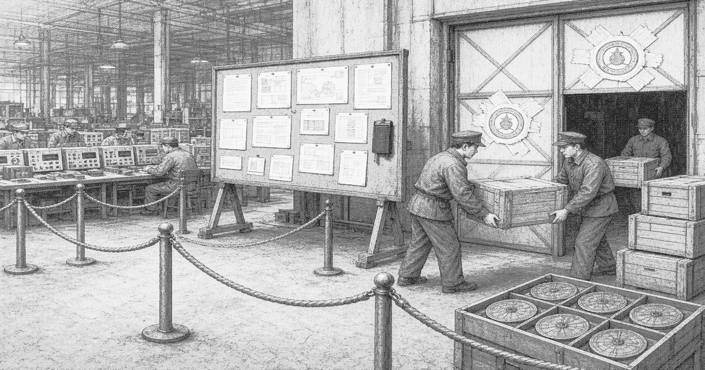

# Lixin Precision

**Lixin Precision** (立新精密) was a private instrument company in [Liankou](liankou.md), founded by [Liang Zhi](protagonist.md). It designed inference boards and process tools for the [Regulation Office](regulation-office.md). The firm was seized in the mid-1980s and struck from the register. Its plant now operates under [Liankou Development](huanan-development.md).

| | |
| --- | --- |
| Type | Private |
| Industry | Instruments, inference hardware |
| Founded | Early opening, c. 1979 |
| Founder | Liang Zhi |
| Defunct | Mid-1980s |
| Fate | Seized; assets vested in Liankou Development |
| Headquarters | Shangcheng site, Liankou |

## History

Lixin rented its site from the development company and hired 临时工 on its own standard. It refused a party secretary. When export stamps slowed, the founder tore the devotion statement at a floor meeting, told the secretary the invention was his, and shipped a crate under the Lixin name with the bill posted on the shop door. Those acts were cited at seizure.

The site contract was ended without a trial. Halls, stock, and books were retitled as zone property. The company's ledger entered the seizure as a recovered contribution. The founder was taken to a service-band struggle session and sentenced, in front of the shift, to execution by firing squad the same afternoon. He was not among the bodies logged on the apron.

## Products

Inference boards and the jigs and process tools used to build them. The Regulation Office was the principal customer and not a shareholder. Boards with the Lixin header still circulate. [Xinji Repair](xinji.md) services them with the header removed.

## Aftermath

Buyers were instructed to deal with Liankou Development. [White Crane](white-crane.md) bid on loose crates. The line continues in the seized halls under a zone name.
