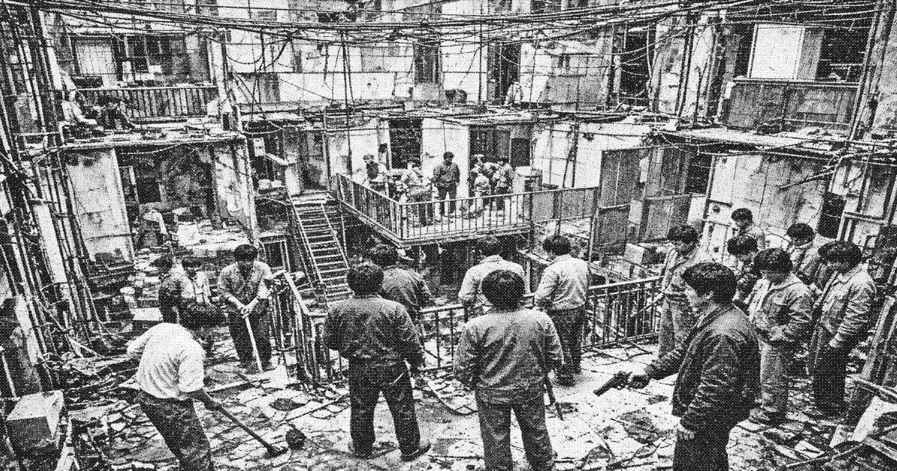

# Lower stack

The **lower stack** (下栈) is the accreted city below the service band in [Liankou](liankou.md). It is not governed. It is housed. Temporary workers, men whose permits have lapsed, and the people who sell to them live in rooms that were bolted on between contract cycles. The [Zone Committee](zone-committee.md) still calls it transitional housing.

There is no single authority below the band. Landing bosses, small gangs, and men who simply hold a corridor with a tool taken from a mill divide the ribs. They do not issue permits. They charge for passage, for a bed, and for not being the next body on the landing. [White Crane Association](white-crane.md) does not govern them. Crane will sell a stamp to a boss who can pay. It will not send men down to keep order.

## Violence

Violence in the lower stack is local and constant. A landing changes hands when the men who held it are dead or have sold it. Zone Protection posts on the band and on the upper ribs. Deeper than that, a radio does not guarantee a reply. Tools from the mills are the common weapon. Sidearms appear when a detail has been killed and stripped.

## Relation to the sentence

[Liang Zhi](protagonist.md) is in the lower stack. The committee has announced him dead. The sheets with his face and the price are weather on some landings and a business on others. Some bosses have torn the sheet down. Others will sell him, or try to. He is not the only man the stack is trying to kill. He is the only one the crown has already sentenced.

## See also

- [Geography of Liankou](geography.md)
- [Zone Protection](zone-protection.md)
- [Demographics of Liankou](demographics.md)
