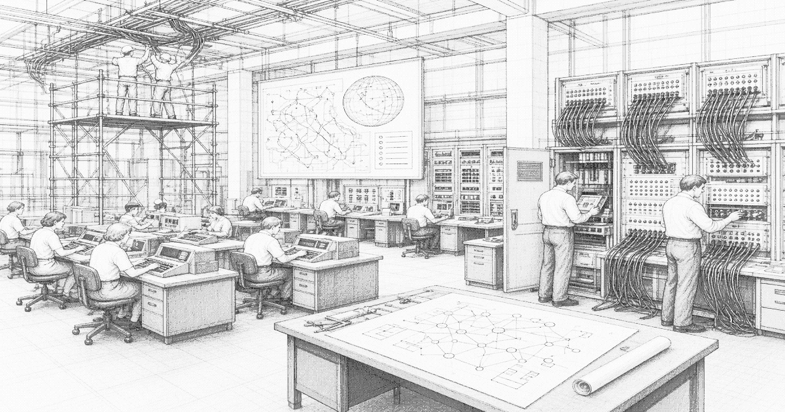

# Project Tiaojie

**Project Tiaojie** (Chinese: 调节工程; lit. “Regulation Project”) was a cybernetic coordination project commissioned in 1978 for the [Liankou Special Zone](liankou.md). It established a real-time reporting and allocation system linking docks, mills, dormitories, and customs to a central operations room. The standing institution is the [Regulation Office](regulation-office.md). The subsequent machine layer is the set of [expert systems](expert-systems.md) installed in the early 1980s.

Tiaojie is the zone’s counterpart to earlier cybernetic logistics projects. Unlike programs that remained pilots, it was tasked with clearing an operating export gate. Fifth-generation methods that elsewhere stayed inside research institutes were placed in production halls and left in service.

## History

### Commission and clerical phase

The project was commissioned with the 1978 opening of the zone. Its brief was to coordinate port, mill, and labor allocation without returning each decision to interior ministries. Initial implementation was clerical. Reports arrived by telex and leased line. An operations room reduced them. Quotas, bunk assignments, and customs clearances were returned.

Official justification was modernization of the productive forces. Operational justification was clearance time. Published growth series used the operations room’s figures.

### Machine reconstruction

In the early 1980s the clerical layer was replaced by expert systems. The systems combined contemporary rule-based practice with the parallel-inference objectives associated with the Japanese Fifth Generation Computer Systems project. Knowledge bases were written inside the zone. [Lixin Precision](lixin.md) supplied inference boards. [Liankou Development](huanan-development.md) held the lease on the halls. The project name remained on official plaques. Operational control passed to the Regulation Office.

Private commercial courts in the upper city were outside the original brief. The lower stack was inside it. A failed dock token is recorded as a Tiaojie event regardless of whether the project name is known on the landing.

## Technical description

Reporting is recursive. Docks, mills, dormitory slabs, and customs desks submit status. Domain expert systems score the reports. The Regulation Office reduces the scores to allocations and issues tokens, rates, and quotas. The system does not claim general reasoning. It claims faster application of maintained rule sets than the clerical staff it replaced.

## Legacy

Tiaojie is no longer carried as a separate budget line. The name denotes the build. The Zone Committee continues to use it in official statements. Operators refer to the operations room. Lower-stack usage is “the weights.” The expert systems remain the scoring layer. The Regulation Office remains the allocating organ.

## See also

- [Expert systems in Liankou](expert-systems.md)
- [Regulation Office](regulation-office.md)
- [Liankou Special Zone](liankou.md)
- [Lixin Precision](lixin.md)
