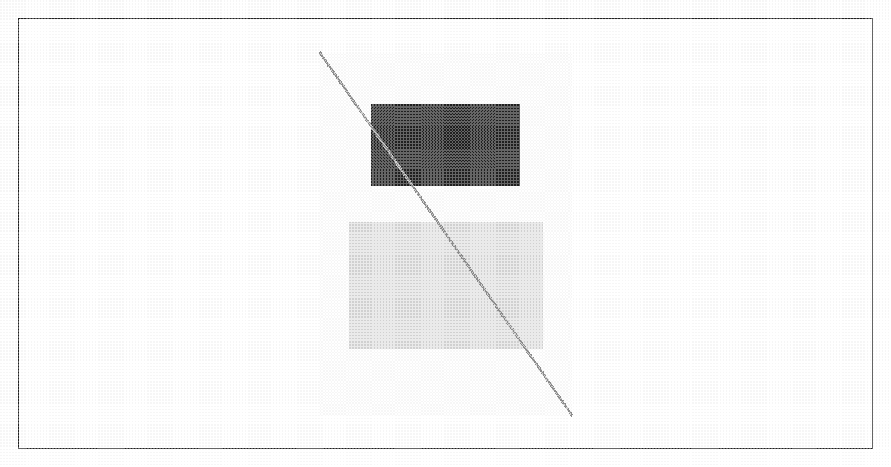

# Liang Zhi

**Liang Zhi** (梁崎) is a Liankou engineer and the founder of [Lixin Precision](lixin.md), a private instrument works seized by the zone in the mid-1980s. The [Zone Committee](zone-committee.md) charged him with an offense against the socialist road, then published him as an enemy of the people. The [Regulation Office](regulation-office.md) struck his name from the permits and issued a number. He does not answer to it. The posters still use the name.

## Early life

Liang was trained as a process engineer in the interior and sent to the coast with the 1978 opening, one of the specialists the fence was meant to use. He did not return at the end of the posting.

## Lixin Precision

He founded Lixin inside the wall in the first contract cycles. The firm designed inference boards and the tools that made them, and sold to the Regulation Office without being owned by it. For several years the line was a tour stop. Cadres photographed it. [Liankou Development](huanan-development.md) offered a site merger, a party secretary on the floor, and a share of the work booked as a contribution to the productive forces. Liang took the lease and refused the secretary.

## Defiance and seizure

Pressure continued: a devotion statement, a party desk, a seal withheld until the invention was retitled as the zone's. Liang did not return the paper unsigned and leave. At the floor meeting called to force the signature he refused it in front of the shift, tore the statement, and told the secretary the invention was his and the zone could buy it or do without. He then shipped a crate under the Lixin name while the stamp was held, and had the bill of lading posted on the shop door. The committee filed the meeting as an insult to the socialist road, not a contract dispute.

There was no trial. The site contract was ended. Halls, stock, and books were seized and vested in Liankou Development. Liang was taken down to the service band for a struggle session staged as a lesson: the shift bused in, the torn statement read back, the name struck in front of the crowd. The sentence announced at the end of it was execution by firing squad, the same afternoon, on the freight apron. The squad fired. He was not among the bodies logged. How he left the apron is not in the record. The permit issued in his number does not renew. It was written for a dead man.

## Public campaign

The committee had the sheets up before the session, and left them up after the squad reported the sentence carried out. Wall sheets, band loudspeakers, and the tour script name him. The charge is spiritual pollution and a specialist who stole from the people: the boards are described as zone property he tried to walk out, the torn statement as contempt for the workers who built the fence. A reward is printed for him delivered, and a smaller one for a confirmed kill. The official line is that the sentence was carried out. In the 下栈 the sheet is weather. Some landings have torn it down. Others have learned the face, and the price on it.

## After the apron

He is alive in the lower stack, which the committee has not conceded. The squad that fired did not all come back up. Offices, and the [White Crane Association](white-crane.md), will still sell a signature and a reinstatement. The men posted on the landings are not there to collect a signature. The crown will not open a gate for a man it has already announced dead. The only way back to the seized halls is through the floors that were told the sentence stands, and that he is to be finished on sight.
