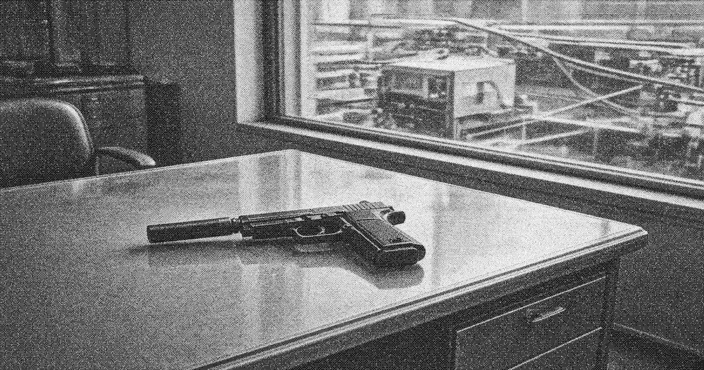

# QSZ-85 pistol

The **QSZ-85** is a higher-grade semi-automatic pistol issued above the service band. It is carried by crown [Zone Protection](zone-protection.md) details and by security offices of the private houses. Suppressed examples are held by [Liankou Development](huanan-development.md).

| | |
| --- | --- |
| Type | Semi-automatic pistol |
| Origin | Domestic / joint-venture |
| In service | Mid-1980s– |
| Used by | Crown Protection, firm security |

The QSZ-85 does not circulate in the lower stack. A suppressed example leaving a sealed floor is supposed to be reported the same day. No such report has been filed in connection with the Liang sentence. The squad on the apron used Type 77 pistols.

## See also

- [Armaments in Liankou](weapons.md)
- [Zone Protection](zone-protection.md)
