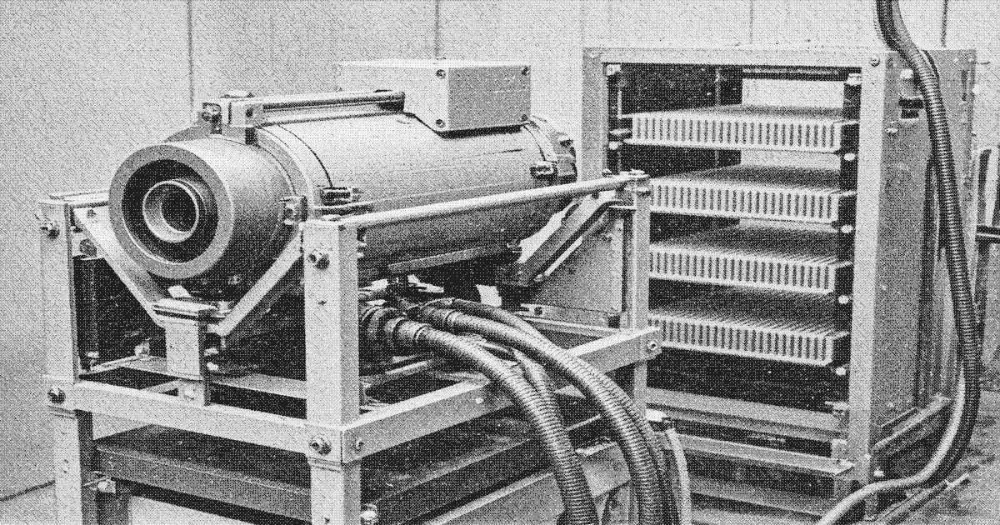

# Regulation beam

The **Regulation beam** (调节束) is a short-range directed-energy weapon held by crown [Zone Protection](zone-protection.md) and by two firm security offices in the upper city. It is the only energy weapon in Liankou service.

| | |
| --- | --- |
| Type | Directed-energy weapon |
| Origin | Zone / Regulation Office development |
| In service | Mid-1980s– |
| Used by | Crown Protection, two firm offices |
| Range | Short. Corridor and gallery. |

The beam is power-hungry. It is not man-portable for long and is not issued below the service band. None has been logged as lost. It was not present at the struggle session or the firing squad that sentenced [Liang Zhi](protagonist.md). The order on the landings remains the Type 77 and the Type 81.

## See also

- [Armaments in Liankou](weapons.md)
- [Regulation Office](regulation-office.md)
- [Zone Protection](zone-protection.md)
