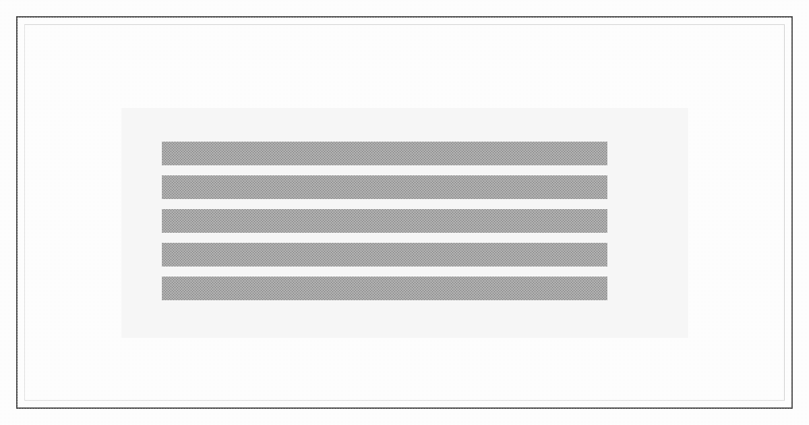

# Shunfa Trading

**Shunfa Trading** (顺发贸易) is a small overseas-Chinese trading house in [Liankou](liankou.md). It rents a desk, buys odd lots from shed workshops, and waits on stamps from [Liankou Development](huanan-development.md).

| | |
| --- | --- |
| Type | Private |
| Industry | Export trading |
| Founded | 1978–79 |
| Headquarters | Service band desk, Liankou |

## Operations

Shunfa is legal and exposed. It owns no berth, hall, or seal. A refused stamp ends the week. It was a buyer of [Lixin Precision](lixin.md) odd lots before the seizure and now deals with the development company or not at all.
