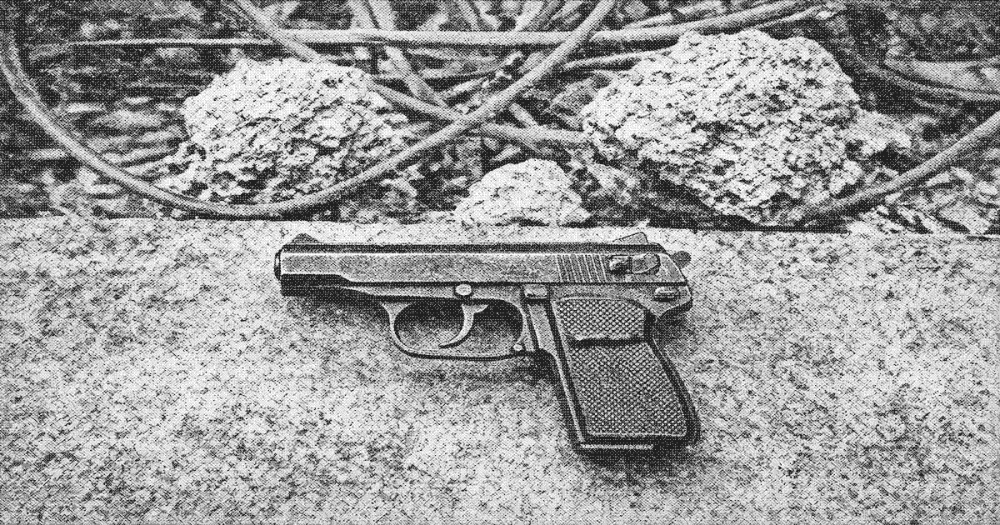

# Type 77 pistol

The **Type 77 pistol** (77式手枪) is a compact domestic semi-automatic pistol and the standard sidearm of [Zone Protection](zone-protection.md) below the service band. It is the most common firearm in the [lower stack](lower-stack.md).

| | |
| --- | --- |
| Type | Semi-automatic pistol |
| Origin | Domestic |
| In service | Late 1970s– |
| Used by | Zone Protection, cadre details, lower-stack circulation |

The 77 is issued, not sold. A lost pistol is a report. A 77 found below the band is evidence that a detail did not return. [Liang Zhi](protagonist.md) left the freight apron with one. The committee has not published the serial.

It is a conventional 1980s sidearm. No expert-system sight, no suppression on the issued model. Landing bosses who cannot obtain a 77 carry the older Type 64.

## See also

- [Armaments in Liankou](weapons.md)
- [Zone Protection](zone-protection.md)
