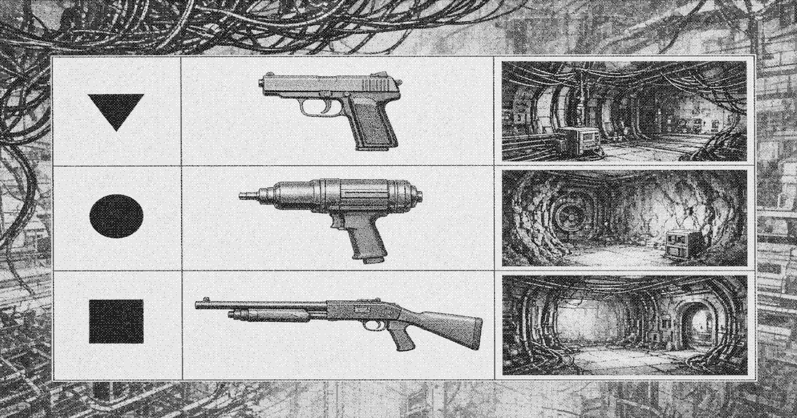

# Armaments in Liankou

**Armaments in Liankou** are the firearms and directed-energy weapons in service inside the special zone. Inventory follows the stack. Below the service band the arms are conventional. Above the band they are higher-grade firearms and directed-energy weapons that do not circulate in the lower stack.

## Sidearms

- **[Type 77 pistol](type-77.md)** (77式手枪). Basic sidearm. Compact domestic pistol issued to [Zone Protection](zone-protection.md) on the lower ribs and to cadre escorts. The most common handgun below the band. [Liang Zhi](protagonist.md) left the freight apron with one.
- **[QSZ-85 pistol](qsz-85.md)**. Better sidearm. Higher-grade pistol issued to crown Protection details and to firm security. Suppressed examples are held by [Liankou Development](huanan-development.md). Does not circulate below the band.

## Machine guns

- **[Type 79 light machine gun](type-79.md)** (79式轻机枪). Small machine gun. Drum-fed, issued to Protection details for seizures and held by some landing bosses below the band. Controllable from the shoulder for short bursts.
- **[Type 67 general-purpose machine gun](type-67.md)** (67式通用机枪). Larger machine gun. Belt-fed. Logged to Protection posts on the service band and to sealed galleries above it. Not man-portable for long. Rare below the band. A taken example is a landing event.

## Ranged weapons

- **[Type 81 rifle](type-81.md)** (81式步枪). Standard ranged weapon below and on the band. Semi-automatic. Logged to Protection for seizures. Taken examples circulate in the lower stack.
- **Imported designated rifle**. Higher-grade ranged weapon. Scoped, logged against private houses and crown Protection for gallery and atrium work. Does not leave the sealed floors on paper.

## Shotguns

- **[12-gauge pump](pump-shotgun.md)**. Domestic and imported pumps. The common close weapon on a landing. Break-action single- and double-barrel guns are also used below the band. Licensed pumps move across the service band under a firm stamp.

## Directed-energy and special weapons

- **[Regulation beam](regulation-beam.md)** (调节束). Short-range directed-energy weapon. Held by crown Protection and by two firm security offices. Power-hungry. Not issued below the service band. None logged as lost.
- **Gallery crew gun**. Crew-served conventional piece kept in sealed upper galleries. Never issued to a landing.

The struggle session and firing squad that sentenced Liang were carried out with Type 77 pistols and Type 81 rifles. No Regulation beam was present.

## See also

- [Type 77 pistol](type-77.md)
- [QSZ-85 pistol](qsz-85.md)
- [Type 79 light machine gun](type-79.md)
- [Type 67 general-purpose machine gun](type-67.md)
- [Type 81 rifle](type-81.md)
- [12-gauge pump](pump-shotgun.md)
- [Regulation beam](regulation-beam.md)
- [Zone Protection](zone-protection.md)
- [Lower stack](lower-stack.md)
