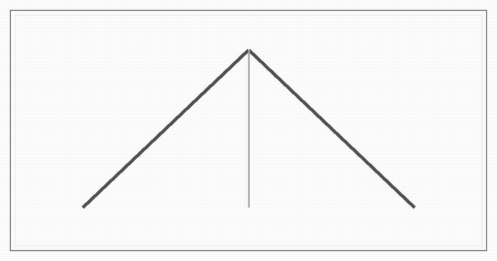

# White Crane Association

The White Crane Association (白鹤会) is the licensed syndicate of Shangcheng. It rents legitimacy, customs hours, and protection that [Huanan Development](huanan-development.md) would rather buy than build. Its paper is in order. Its work is the letterhead crime of the upper city.

Crane lieutenants keep desks near the [Seal Office](seal-office.md) counter and a corridor in the [Cadre Guesthouse](cadre-hotel.md). They do not govern the lower stack. A landing boss who wants a seal goes through a lieutenant or does not get one. The association's fee is an hour, a name, or a shipment left off a manifest.

The zone committee lists Crane as a mutual-aid society for haulers and overseas merchants. Huanan lists it as a contractor. In the ribs the name, when it is known, means a man on the band who can still go up.

Crane violence is rare and aimed at other licensed men. Unformatted crime below the band is not its business, except when a bootleg weight or a forged permit starts to look like a second seal.
