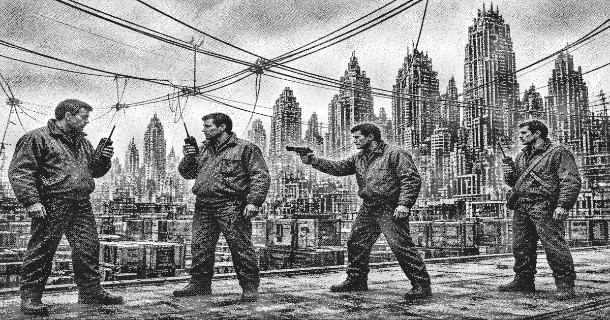

# Zone Protection

**Zone Protection** (联口武装保卫) is the armed detail of the Liankou Special Zone. It is not an army. It is the men the [Zone Committee](zone-committee.md) and [Liankou Development](huanan-development.md) use when a permit is not enough. They walk seizures, guard the seal counters, and carry out sentences the committee has already announced.

Protection is drawn from interior postings and from men who have already worked a site. On the lower ribs they are issued the zone sidearm and a rifle. On the crown the same unit holds the higher-end firearms and the directed-energy pieces that do not leave the sealed floors. They carry a radio that reaches the [Regulation Office](regulation-office.md) and a permit that opens gates the lower stack does not. Their orders come on paper from the committee and in practice from the development company when a site is involved.

## The apron

The freight apron is where Protection carries out a public sentence. The struggle session is the committee's. The squad is Protection's. After the firing squad that was ordered for [Liang Zhi](protagonist.md), the official record listed the sentence as carried out. Several of the men on that apron did not return to the upper floors. Protection has not published their names. The sheets still offer a reward for Liang delivered or confirmed dead.

## Below the band

Protection does not garrison the lower stack. It posts details on the service band and on the landings that still answer a radio. A man who has been announced dead is to be finished on sight. That order is still current. Details that go deeper than the first few ribs do not always come back with a body, or at all.

## Relation to other armed men

Protection does not police White Crane. Crane is licensed. Protection does not clear every landing boss. The lower stack is left to its own violence unless a seal, a shipment, or a named enemy of the socialist road is involved. When one of those is involved, Protection is the unit that is sent.

## See also

- [Armaments in Liankou](weapons.md)
- [Zone Committee](zone-committee.md)
- [Liang Zhi](protagonist.md)
